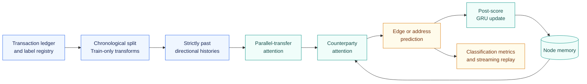

<div align="center">

# DMT-GNN · AML

### Directed Multigraph Temporal Learning for Anti-Money Laundering

Preserve every transfer. Learn from the past. Measure the cost of freshness.

[](https://github.com/Saif1Shahzad/dmt-gnn-aml/actions/workflows/tests.yml)


**[Quick start](#quick-start)** · **[Current progress](#current-progress)** · **[Experiment guide](docs/EXPERIMENTS.md)** · **[Research protocol](docs/PROTOCOL.md)**

</div>

---

## Overview

Money laundering is a pattern across transfers, counterparties, and time. Collapsing repeated transfers into one edge can remove information about how that pattern develops. Updating a detector less frequently can also change what it knows when an event arrives.

**DMT-GNN AML** is a research implementation for studying both effects. It combines directional multigraph attention with continuous-time features and recurrent node memory, then evaluates the trade-off between detection quality, information freshness, and processing latency.

The project implements the Phase 2 research plan by **Saif Shahzad** and **Shahoud Shahid**, with two intended evaluation domains:

| Dataset | Prediction task | Role in the study |
| :--- | :--- | :--- |
| **IBM AML HI-Small** | Is this transfer laundering? | Synthetic financial transaction benchmark |
| **XBlock Ethereum** | Is this address labeled malicious? | Real-world cryptocurrency address benchmark |

> [!IMPORTANT]
> **Current stage: the research pipeline is implemented and verified on synthetic fixtures.** Full IBM/XBlock experiments have not yet been run. This repository does not claim benchmark accuracy, production latency, or superiority over published methods.

## Current progress

**Progress snapshot · November 3, 2026**

| Workstream | Status | Evidence or next step |
| :--- | :---: | :--- |
| Research scope and protocol | ✅ Documented | [Methodology mapping](docs/TRACEABILITY.md) and explicit implementation decisions |
| Data ingestion and temporal splits | ✅ Implemented | IBM adapter, configurable XBlock import, train-only scaling, preserved parallel edges |
| DMT-GNN and ablations | ✅ Implemented | Hierarchical attention, harmonic time features, GRU memory, edge/node heads |
| Training and validation | ✅ Verified on fixtures | Checkpoint reload, calibrated thresholds, early stopping, recurrent gradient checks |
| Baseline controls | ✅ Implemented | XGBoost, merged DMT, and clearly labeled internal TGN/Multi-GNN controls |
| Streaming evaluation | ✅ Verified on fixtures | Event, micro-batch, time-bucket, and XGBoost refresh replay |
| Tuning and comparisons | ✅ Smoke-verified | One Optuna trial; a two-seed, two-variant suite with paired analysis |
| Local regression suite | ✅ 18 tests passed | Causality, preprocessing, model variants, training, metrics, and replay |
| GitHub Actions | ✅ Passed on published code | [Verified CI run](https://github.com/Saif1Shahzad/dmt-gnn-aml/actions/runs/41573751287); live badge above |
| Full IBM/XBlock evaluation | ⏳ Pending | Acquire data, validate schemas, profile a representative pilot |
| Official baseline reproductions | ⏳ Pending | Internal controls are not official TGN/Multi-GNN implementations; MEGA is not integrated |
| Scientific results and manuscript | ⏳ Pending | Complete frozen-protocol runs before drawing conclusions |

The [validation record](docs/VALIDATION.md) distinguishes completed checks from unverified hardware, scale, and research claims.

## How the pipeline works



**The causal rule:** score an event before allowing it to update memory. Events with the same timestamp are scored from the same prior state; sampled neighbors must have strictly earlier timestamps.

The pipeline also keeps negative examples, learns transforms only from training data, and selects thresholds and hyperparameters on validation data. Test labels never enter the graph memory. These behaviors have regression coverage in [`tests/test_pipeline.py`](tests/test_pipeline.py).

## Quick start

**Recommended environment:** Python 3.12, a virtual environment, and a POSIX shell. The package declares Python 3.10+ support; CI and Docker target 3.12.

```bash
git clone https://github.com/Saif1Shahzad/dmt-gnn-aml.git
cd dmt-gnn-aml

python3 -m venv .venv
source .venv/bin/activate
python -m pip install -e '.[dev]'
source scripts/activate.sh

python -m pytest -q
bash scripts/smoke.sh
```

The smoke workflow generates independent toy data and completes preparation → training → evaluation → replay → reporting. It requires no benchmark download.

```text
runs/smoke/
├── data/                  Prepared toy events and provenance
├── model/                 Checkpoint, validation metrics, and training history
├── test/                  Held-out predictions and metrics
├── replay/                Predictions, queue timing, and freshness measurements
└── report/                Results table and quality–latency plot
```

> [!TIP]
> Each run needs a fresh output directory. To repeat the smoke workflow, use `bash scripts/smoke.sh runs/smoke2`. Generated data, environments, checkpoints, and results are ignored by Git.

<details>
<summary><strong>Platform and dependency notes</strong></summary>

- **macOS:** the activation script and CLI launcher select PyTorch's bundled OpenMP runtime before numerical libraries load. This avoids the PyTorch/XGBoost runtime conflict encountered during local verification. Use `python -m pytest` after activation. If a system OpenMP runtime is needed, install it with `brew install libomp`.
- **Linux:** the OpenMP runtime must be available; the supplied Dockerfile installs `libgomp1`.
- **NVIDIA GPU:** install the appropriate CUDA-enabled PyTorch build, then set `device: cuda` in a copied configuration. GPU and MPS execution have not been verified in this project.
- **Reproducibility:** [`requirements-tested.txt`](requirements-tested.txt) records the tested Mac environment; it is not a universal platform lock. [`pyproject.toml`](pyproject.toml) defines dependency ranges.
- **Containers:** a [`Dockerfile`](Dockerfile) and [Conda environment specification](configs/environment.yml) are supplied. The Docker build has not yet been verified.

</details>

## From downloaded data to an experiment

For IBM, place the original `HI-Small_Trans.csv` under `data/raw/ibm/` and run:

```bash
# 1. Preserve transfers and create chronological train/validation/test partitions.
dmtgnn prepare --format ibm \
  --input data/raw/ibm/HI-Small_Trans.csv \
  --out data/processed/ibm

# 2. Train and select a checkpoint using validation data.
dmtgnn train --data data/processed/ibm \
  --config configs/default.yaml \
  --out runs/ibm/dmt/seed_42

# 3. Evaluate the frozen checkpoint and validation-selected threshold.
dmtgnn evaluate --data data/processed/ibm \
  --checkpoint runs/ibm/dmt/seed_42/checkpoint.pt \
  --out runs/ibm/dmt/seed_42/test
```

For XBlock, the importer expects a transaction CSV plus an explicit `address,label` registry. Column mappings and a trusted NetworkX multigraph converter are provided; unknown addresses remain unlabeled rather than automatically becoming negatives.

**Continue with the [dataset contracts](docs/DATASETS.md) and [complete experiment guide](docs/EXPERIMENTS.md)** for XBlock preparation, tuning, five-seed suites, streaming sweeps, statistics, and case studies.

## Experiment design

### Models and controlled comparisons

| Model / option | What it tests |
| :--- | :--- |
| `dmt` | Hierarchical directed multigraph learning with temporal memory |
| `merged` | Loss of parallel-transfer detail within sampled histories |
| `no_direction` | Shared directional weights and symmetric message pooling |
| `no_memory` | Local historical structure without recurrent node memory |
| `single_stage` | Edge aggregation without per-counterparty hierarchy |
| `tgn_reference` | Internal simple-history temporal memory control |
| `multignn_reference` | Internal directional, edge-attribute, port/order control |
| `xgboost` command | Tabular learning from event attributes and causal graph features |
| `loss: bce` / sampling budget | Loss-function and neighborhood-size controls |

The default suite includes DMT, merged, no-direction, no-memory, and both internal reference controls. Single-stage, BCE, and alternate sampling budgets are selected separately through configuration.

### Planned operating conditions

| Dimension | Configured protocol |
| :--- | :--- |
| Temporal partition | Approximately **60 / 20 / 20**, with timestamp groups kept together |
| Random seeds | **42, 101, 202, 303, 404** |
| Hyperparameter search | Up to **20** validation-only Optuna TPE trials |
| Neural refresh | Event; batches of **10 / 50 / 100**; ledger-time buckets of **60 / 600 / 3600 s** |
| Offered arrival rates | **10 / 100 / 1000 events/s** by default |
| Tabular refresh study | Every **100 / 1000 / 10000** events |
| Primary model defaults | Hidden size **64**, **4** attention heads, **10** historical transfers per direction |

These settings define experiments to run; they are not completed benchmark results. Profile a representative pilot before launching the full matrix. The implementation uses a correctness-first event loop, so full-scale runtime and memory must be measured.

### Outputs and measurements

| Area | Available outputs |
| :--- | :--- |
| Detection quality | Minority precision, recall, F1, average precision, MCC, and P@100/500 |
| Streaming behavior | Measured inference/service latency, simulated FIFO queue delay, p50/p95/p99, throughput, and staleness |
| Statistical comparison | Paired seed/time-block bootstrap, Wilcoxon tests, Holm correction, Cliff's delta, and rank-biserial correlation |
| Diagnostics | Top false positives/negatives; temporal, degree, multiplicity, and available typology strata |
| Case studies | True-positive causal prefix replay with selected historical events deleted |
| Reproducibility | Source hashes, data manifests, configuration, environment details, checkpoints, and prediction CSVs |

Average precision is the implementation's explicit PR-AUC definition. Inference latency and simulated end-to-end latency are reported separately. Incident detection delay remains unavailable without incident onset annotations.

## Roadmap

- [x] Translate the Phase 2 plan into a documented experiment protocol.
- [x] Implement causal ingestion, the proposed model, controls, and training workflows.
- [x] Verify edge and node tasks on synthetic fixtures.
- [x] Add streaming replay, statistical analysis, diagnostics, and case studies.
- [x] Publish the repository and pass the initial GitHub CI run.
- [ ] Acquire and audit the intended IBM and XBlock releases.
- [ ] Profile representative workloads and validate the selected GPU environment.
- [ ] Complete full tuning and the five-seed benchmark matrix.
- [ ] Reproduce official baselines under matched data and evaluation protocols.
- [ ] Add authoritative typology/incident annotations where available.
- [ ] Produce empirical comparison tables, figures, and the research manuscript.

## Documentation and code map

| Start here | Purpose |
| :--- | :--- |
| [Dataset contracts](docs/DATASETS.md) | Formats, label policies, units, importers, and provenance |
| [Experiment guide](docs/EXPERIMENTS.md) | Commands for training, tuning, replay, comparison, and reporting |
| [Research protocol](docs/PROTOCOL.md) | Causality, model decisions, evaluation units, and known limitations |
| [Validation record](docs/VALIDATION.md) | What has actually been checked |
| [Requirement traceability](docs/TRACEABILITY.md) | Mapping from the research document to implementation |
| [Source provenance](docs/SOURCE.md) | Research-plan authorship and document hash |

<details>
<summary><strong>Explore the repository structure</strong></summary>

```text
dmt-gnn-aml/
├── src/dmtgnn/
│   ├── data.py            CSV adapters, temporal splits, and feature transforms
│   ├── model.py           Causal state, attention, memory, and ablations
│   ├── engine.py          Training, validation, evaluation, and checkpoints
│   ├── streaming.py       Neural replay and measured-service queue simulation
│   ├── tabular.py         XGBoost training and streaming replay
│   ├── experiments.py     Optuna search and fixed-seed experiment suites
│   ├── metrics.py         Classification metrics and address-level reduction
│   ├── analysis.py        Paired statistics, diagnostics, and figures
│   ├── explain.py         Causal event-deletion case studies
│   ├── synthetic.py       Independent verification fixtures
│   ├── bootstrap.py       Platform-aware command launcher
│   ├── cli.py             Experiment command-line interface
│   └── utils.py           Configuration, seeding, hashing, and serialization
├── configs/               Model settings and dataset column mappings
├── scripts/               Activation, smoke runs, suite analysis, and conversion
├── tests/                 Causality and integration regression coverage
├── docs/                  Research protocol and experiment documentation
├── .github/workflows/     Automated verification
└── Dockerfile             Container environment definition
```

</details>

## Research boundaries

The internal TGN/Multi-GNN controls must not be presented as official reproductions. MEGA-GNN is not integrated. Causal deletion replay is a qualitative diagnostic, not GNNExplainer. Address labels are retrospective unless their availability times are explicitly modeled. Queue results come from a measured-service simulation, not a deployed monitoring service.

The original research document is retained outside this repository. Benchmark data and their licenses are separate from the implementation; no benchmark dataset or real-data trained checkpoint is distributed here. Full details are in the [protocol](docs/PROTOCOL.md).

---

<div align="center">

**Saif Shahzad · Shahoud Shahid**<br>
Computer Networks Research Project · FAST-NUCES · 2026

[Explore the code](src/dmtgnn) · [Read the protocol](docs/PROTOCOL.md) · [View CI](https://github.com/Saif1Shahzad/dmt-gnn-aml/actions)

</div>
